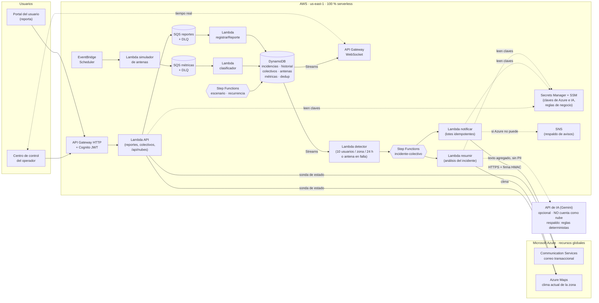

# Arquitectura

> **Estado: implementado y verificado en AWS + Azure** (stage `dev-rodrigo`, 14-nov-2026). Para cambiar algo de aquí, abre un issue `decision` y registra el resultado en `docs/decisiones/`.
>
> **Ya decidido:** AWS Academy Learner Lab (`LabRole`), `us-east-1`, Serverless Framework, Python y DynamoDB con tablas separadas.
> **Segunda nube: Microsoft Azure** (Communication Services para el correo y Maps para el clima), ver [`decisiones/2026-11-14-segunda-nube-azure.md`](decisiones/2026-11-14-segunda-nube-azure.md). GCP quedó descartado.

## Vista general

**Qué hace cada nube (y por qué la integración es real):**

| Nube | Servicio | Qué ocurre de verdad |
|---|---|---|
| AWS | API Gateway, Lambda, SQS, DynamoDB, Step Functions, Cognito, EventBridge, Secrets Manager/SSM, S3 | Ingesta, detección, orquestación, datos, autenticación y secretos |
| Azure | **Communication Services** | Cada aviso del flujo (`EN_EVALUACION`, `INCIDENCIA_CONFIRMADA`, `SERVICIO_RESTABLECIDO`) sale por correo desde una Lambda de AWS, autenticado con firma HMAC-SHA256. El historial guarda el id de operación de ACS y se puede consultar su entrega (`Succeeded`) |
| Azure | **Maps** | El análisis del incidente incluye el clima actual del centro de la zona (lluvia, viento, temperatura): una causa plausible de caída que el operador necesita ver |
| API externa | Gemini (opcional) | Redacta hipótesis y recomendaciones sobre datos **agregados** (sin datos personales). Si no está disponible, el análisis lo genera una plantilla de reglas y la interfaz lo rotula «Reglas», nunca «IA» |

## Por qué así (relación con la rúbrica)

| Decisión | Motivo |
|---|---|
| SQS + DLQ delante de todo lo que escribe | Absorbe picos sin perder registros; las Lambdas escalan solas |
| DynamoDB on-demand + PITR | Serverless, multi-AZ por defecto, pago por uso, respaldo continuo |
| DynamoDB Streams → detector | Reacción en tiempo casi real sin polling |
| Step Functions | Flujos con estados, esperas y reintentos (incidente colectivo, recurrencia) |
| Azure: Communication Services + Maps | 2.ª nube con rol real y verificable: los avisos salen por Azure y el análisis usa su clima. La suscripción de estudiante solo permite recursos de ubicación `global` (política «Allowed locations»), que bastan para estos dos servicios |
| Secrets Manager / SSM | Requisito explícito de la rúbrica |
| EventBridge Scheduler | Simulador y tareas periódicas sin servidores encendidos |

## Reglas de negocio (fuente de verdad)

- **Clasificación de antena** por GB/min: `0` → `INHABILITADA`; `<60` → `CAIDA`; `60..129` → `NORMAL`; `>129` → `SATURADA`.
- **Estados de incidencia**: `REGISTRADA → EN_REVISION → EN_ATENCION → SOLUCIONADA → CERRADA`. Cada transición genera un evento de historial.
- **Incidente colectivo**: al menos 10 `usuarioId` distintos con reportes en la misma `zonaId` en una ventana de menos de 24 h.
- **Prioridad**: función de los afectados, la criticidad de la zona (`contracts/zonas.json`) y las antenas en falla. La fórmula exacta va en `docs/decisiones/`.
- **Recurrencia**: umbral pendiente de decisión (sugerencia: 3 o más incidentes de la misma antena en 7 días → `ESTRUCTURAL`).

## Decisiones abiertas

Ver [`docs/decisiones/README.md`](decisiones/README.md). **Nadie las resuelve solo**: van por un issue `decision`.

## Inventario de recursos

> Actualízalo en el mismo PR que crea el recurso. Formato: `telecorp-<stage>-<nombre>`.

| Recurso | Nube / servicio | Nombre | Módulo | Notas |
|---|---|---|---|---|
| Tabla `incidencias` (GSI `zona-fecha`, Stream, PITR) | AWS DynamoDB | `telecorp-<stage>-incidencias` | base | E1 crea; se usa desde E2 |
| Tabla `historial` (PITR) | AWS DynamoDB | `telecorp-<stage>-historial` | base | Solo inserciones |
| Tabla `metricas` (TTL 7 d, PITR) | AWS DynamoDB | `telecorp-<stage>-metricas` | base | Serie por antena |
| Tabla `antenas` (Stream, PITR) | AWS DynamoDB | `telecorp-<stage>-antenas` | base | Estado actual |
| Tabla `colectivos` (GSI `zona-estado`, PITR) | AWS DynamoDB | `telecorp-<stage>-colectivos` | base | Se usa desde E3 |
| Tabla `dedup` (TTL 24 h) | AWS DynamoDB | `telecorp-<stage>-dedup` | base | Clave condicional `usuario#zona` (E2) |
| Colas `reportes`, `metricas` + DLQ | AWS SQS | `telecorp-<stage>-{reportes,metricas}[-dlq]` | base | 3 reintentos → DLQ (14 d) |
| Parámetro del simulador | AWS SSM | `/telecorp/<stage>/simulador` | base | Fallas forzadas |
| Secreto de IA | AWS Secrets Manager | `telecorp/<stage>/ia` | base | `{geminiApiKey, modelo}`; sin él, el análisis usa reglas |
| Layer Python común | AWS Lambda | `telecorp-<stage>-comun` | base | `telecorp.*` |
| Simulador + programación | AWS Lambda + EventBridge Scheduler | `telecorp-<stage>-simulador` | antenas | Apagado por defecto |
| Clasificador | AWS Lambda (SQS) | `telecorp-<stage>-clasificador` | antenas | Respuesta parcial de lote |
| HTTP API | AWS API Gateway v2 | `telecorp-<stage>-api` | api | `/api/*` + frontend |
| Tabla `dedup`: también el candado `COLECTIVO#zona` | AWS DynamoDB | `telecorp-<stage>-dedup` | base / workflows | Un solo colectivo abierto por zona |
| Tópicos `avisos` y `alertas-operador` | AWS SNS | `telecorp-<stage>-{avisos,alertas-operador}` | base | Email a usuarios (FilterPolicy) y alertas del NOC |
| Parámetro de reglas | AWS SSM | `/telecorp/<stage>/reglas` | base | Umbral colectivo, ventana, espera, pesos de prioridad (D7) |
| DLQ del detector | AWS SQS | `telecorp-<stage>-detector-dlq` | base | `onFailure` de los streams |
| Detector | AWS Lambda (DynamoDB Streams ×2) | `telecorp-<stage>-detector` | workflows | Filtro: INSERT de incidencias; antenas en CAIDA/INHABILITADA |
| Step Function `incidente-colectivo` | AWS Step Functions (Standard) | `telecorp-<stage>-incidente-colectivo` | workflows | Map, Choice, Wait, Retry, Catch, SNS directo |
| User Pool + cliente web + trigger PreSignUp | AWS Cognito + Lambda | `telecorp-<stage>-usuarios`, `telecorp-<stage>-pre-registro` | base | D9: auto-confirmación y validación del perfil |
| Tabla `estadisticas` (TTL 35 d, PITR) | AWS DynamoDB | `telecorp-<stage>-estadisticas` | base | D10: contadores de 15 min |
| GSI `usuario-fecha` en `incidencias` | AWS DynamoDB | — | base | "Mis reportes" |
| Autorizador JWT (Cognito) | AWS API Gateway v2 | `cognito` | api | Protege `POST /api/reportes` y `/api/mis-reportes` |
| Step Function `escenario` | AWS Step Functions (Standard) | `telecorp-<stage>-escenario` | workflows | E5: tormenta o corte de energía en oleadas (Map secuencial + Wait) |
| Parámetro del escenario en curso | AWS SSM | `/telecorp/<stage>/escenario` | base | Estado visible en el panel |
| Step Function `recurrencia` + programación diaria | AWS Step Functions + EventBridge Scheduler | `telecorp-<stage>-recurrencia` | workflows | E6: cron 06:00 America/Lima; Choice + Map |
| Parámetro de la última recurrencia | AWS SSM | `/telecorp/<stage>/recurrencia` | base | |
| WebSocket API | AWS API Gateway v2 (WebSocket) | `telecorp-<stage>-tiempo-real` | api | E7: `$connect`, `$disconnect`, `$default` (ping) |
| Tabla `conexiones` (TTL 2 h) | AWS DynamoDB | `telecorp-<stage>-conexiones` | base | Conexiones abiertas del panel |
| Difusor | AWS Lambda (DynamoDB Streams ×3) | `telecorp-api-<stage>-difusor` | api | Avisa a los paneles cambios en antenas, colectivos e incidencias; borra conexiones caídas |
| Stream de `colectivos` (KEYS_ONLY) | AWS DynamoDB | — | base | Para el difusor |
| Bucket del frontend (versionado, privado) | AWS S3 | `telecorp-api-<stage>-bucketfrontend-*` | api | Servido por la Lambda `web` (CloudFront bloqueado) |
| Secreto de Azure | AWS Secrets Manager | `telecorp/<stage>/azure` | manual | `{acsEndpoint, acsKey, acsSender, mapsKey}`; lo leen las Lambdas con `LabRole`. Se crea con `az` (no está en el repo) |
| Azure Communication Services + Email Service + dominio administrado | Azure | `tccomm*`, `tcemail*` (grupo `rg-telecorp-probe2`, ubicación `global`) | manual | Correo transaccional. Límite del dominio administrado: 5/min y 10/h (el código respeta 5/min y 8/h) |
| Azure Maps (Gen2) | Azure | `tcmaps*` (ubicación `global`) | manual | Clima actual (`weather/currentConditions`) |
| Lambda `nubes` | AWS Lambda + API Gateway | `telecorp-api-<stage>-nubes` | api | `GET /api/nubes` (solo operadores): mide en vivo AWS y Azure; sondas con cupo de 1 cada 5 min por servicio |
| Contadores, cupos y disyuntores de las integraciones | AWS DynamoDB | `telecorp-<stage>-dedup` (`NUBE#`, `LIMITE#`, `DISYUNTOR#`) | base | Sin tablas nuevas |
